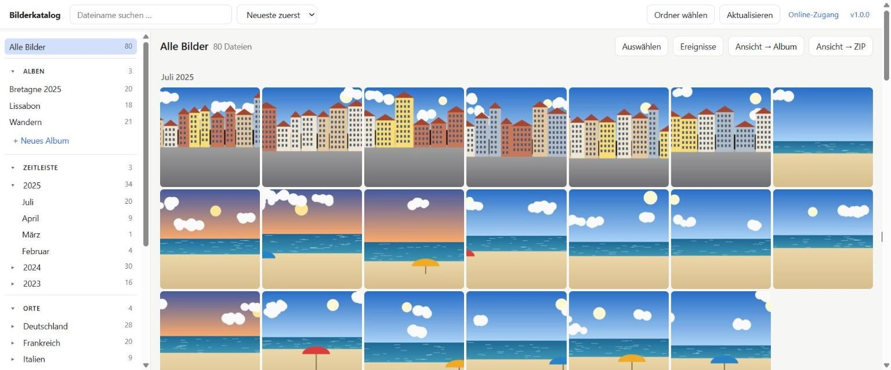

# Bilderkatalog für OneDrive

Ein lokales Programm, das deine Bilder und Videos in OneDrive über ihre **Metadaten** kennt, ohne sie zu verschieben, umzubenennen oder zu kopieren. Es funktioniert **ohne Anmeldung und ohne Azure-Registrierung** direkt mit deinem OneDrive-Ordner auf dem PC.

- **Sortieren und Filtern** nach Datum, Jahr, Monat, Ort (Land/Stadt), Ordner, Kamera und Dateiname
- **Virtuelle Ordner (Alben) und Favoriten:** Bilder frei zusammenstellen oder mit einem Stern markieren. Ein Bild kann in mehreren Alben liegen.
- **Doppelte Dateien** erkennen (gleiche Größe und gleiche Aufnahmezeit oder gleicher Name) und auf Wunsch überall ausblenden – oder gezielt in den Papierkorb verschieben.
- **Aufnahmedatum und Ort korrigieren oder ergänzen**, z. B. für eingescannte Fotos („07.1998“) oder Bilder ohne GPS. Ortssuche offline mit deutschen Namen oder per Koordinaten. Gilt nur im Katalog.
- **Vorschaubilder auch für „Nur online“-Dateien und Videos**, ohne Download (Windows/OneDrive liefert sie aus der Cloud)
- **Ereignisse:** Bilder, die zeitlich und örtlich zusammengehören (z. B. ein Urlaubstag), werden automatisch erkannt und lassen sich als Album übernehmen.
- **ZIP-Export** einer Auswahl, eines Albums oder der aktuellen Ansicht, wahlweise flach, nach Jahr/Monat oder in der Ordnerstruktur
- **Prüflisten:** ohne Aufnahmedatum, ohne GPS, Videos, doppelte Dateien, Datum/Ort von Hand gesetzt, Nur-online-Bilder ohne Details
- **Sicherung** von Alben, Favoriten, Datums- und Ortskorrekturen als kleine Datei, die sich auch auf einem anderen PC einspielen lässt

> **Deine Bilder werden nicht verändert.** Alben, Gruppen, Favoriten und Korrekturen existieren nur in einer lokalen SQLite-Datenbank. Das Programm liest Dateien nur. Für „Nur online“-Dateien setzt es höchstens den Status „Speicherplatz freigeben“ zurück, und den hatten sie vorher ohnehin. Einzige Ausnahme: **Löschen** – nur auf ausdrücklichen Wunsch mit eigener Bestätigung, nur für lokal erfasste Ordner und immer in den Papierkorb.

**Webseite:** <https://mbruver-source.github.io/bilderkatalog/> · **Handbuch:** [docs/HANDBUCH.md](docs/HANDBUCH.md) · **Download:** [Releases](https://github.com/mbruver-source/bilderkatalog/releases/latest)



*English summary: A local photo catalogue for your OneDrive folder that needs no Azure app registration. It indexes metadata (date, GPS, camera), resolves places offline, and lets you filter, group into virtual albums and export ZIPs. Files are never modified. Optional read-only Microsoft Graph access. UI language: German.*

## So funktioniert es

```
Browser (localhost) ─► Python-Server (FastAPI) ─► SQLite-Datenbank (lokal)
                              │
                              ├─► OneDrive-Ordner auf dem PC (lesen; Löschen nur nach Bestätigung, in den Papierkorb)
                              ├─► Offline-Ortsauflösung (GeoNames-Datensatz, keine Online-Abfrage)
                              └─► optional: Microsoft Graph API (nur lesend)
```

### „Nur online“-Dateien

Mit „Dateien bei Bedarf“ liegen viele Bilder nur als Platzhalter auf dem PC. Das Programm behandelt sie so:

1. **Einlesen:** Das Programm öffnet die Datei nicht und lädt nichts herunter. Das **Aufnahmedatum** steht trotzdem sofort zur Verfügung, weil Windows es im Platzhalter speichert. Das **Vorschaubild** holt Windows beim ersten Anzeigen über OneDrive aus der Cloud, ebenfalls ohne die Datei herunterzuladen. Ort und Kamera fehlen zunächst. In der Seitenleiste erscheinen diese Bilder unter „Nur online, Details fehlen“.
2. **Details nachladen** (Schaltfläche oben, optional): Jedes Bild wird **einzeln** heruntergeladen. Das Programm liest GPS, Kamera und Abmessungen aus und **gibt den Speicher sofort wieder frei**, genau wie „Speicherplatz freigeben“ im Explorer. Das dauert etwa 1 Sekunde pro Bild, läuft im Hintergrund und lässt sich jederzeit abbrechen und später fortsetzen. Bei weniger als 2 GB freiem Speicher hält das Nachladen an.

Statt alles auf einmal kannst du auch gezielt nachladen:

- **Details nachladen (Anzahl)** in der Ansicht lädt nur die Bilder des aktuellen Filters, etwa ein Album, einen Monat oder einen Ort.
- **Details nachladen** in der Auswahlleiste lädt nur die markierten Bilder.
- **Details laden** in der Großansicht lädt sofort das eine Bild.

Bilder, die schon lokal vorhanden sind, werden direkt vollständig gelesen.

### Weitere Details

- Fehlt ein EXIF-Datum, wird es aus dem Dateinamen gelesen (z. B. `IMG-20190312-WA0001.jpg`) und erst danach aus der Änderungszeit der Datei. Die Quelle wird jeweils angezeigt.
- GPS-Koordinaten werden **offline** in Stadt, Region und Land umgewandelt (`reverse_geocoder`), mit deutschen Namen („München“, „Lissabon“, „Bayern“).
- Spätere Aktualisierungen lesen nur neue oder geänderte Dateien. Verschobene oder umbenannte Bilder behalten ihre Albumzuordnung.
- Funktioniert auch mit jedem anderen Ordner, etwa einer externen Festplatte. Die Platzhalter-Funktionen gibt es nur unter Windows.

## Installation (Windows)

1. Auf der Seite [Releases](https://github.com/mbruver-source/bilderkatalog/releases) die
   neueste Datei `Bilderkatalog-Setup-X.Y.Z.exe` herunterladen.
2. Doppelklicken und den Anweisungen folgen. Adminrechte sind nicht nötig.
3. Die Setup-Datei ist nicht signiert. Windows zeigt deshalb beim ersten Start eventuell
   „Der Computer wurde durch Windows geschützt“. Dann **Weitere Informationen → Trotzdem ausführen** klicken.

Für ein **Update** die neue Setup-Datei einfach über die alte Version installieren. Katalog,
Alben und Vorschaubilder bleiben erhalten. Ob es eine neue Version gibt, zeigt im Programm
der Knopf mit der Versionsnummer oben rechts → **Nach Updates suchen**.

## Installation für Entwickler (alle Systeme)

Voraussetzung: Python 3.10 oder neuer. Unter macOS/Linux funktionieren normale Ordner, die
OneDrive-Platzhalter-Funktionen gibt es nur unter Windows.

```bash
git clone https://github.com/mbruver-source/bilderkatalog.git
cd bilderkatalog
python -m venv .venv
# Windows:      .venv\Scripts\activate
# macOS/Linux:  source .venv/bin/activate
pip install -e ".[dev]"
# optional für HEIC-Fotos (iPhone):
pip install ".[heic]"
```

Wie der Windows-Installer gebaut und ein Release veröffentlicht wird, steht in
[README_INSTALLER.md](README_INSTALLER.md).

## Start

```bash
bilderkatalog
```

Das Programm öffnet sich in einem **eigenen Fenster**. Unter Windows nutzt es dafür den eingebauten Edge-WebView2. Schließt du das Fenster, wird das Programm beendet. Unter Windows startet `bilderkatalog-app` dasselbe Fenster ohne Konsolenfenster, das eignet sich gut für eine Desktop-Verknüpfung.

Danach:

1. **Ordner wählen:** Dein OneDrive-Ordner wird automatisch angezeigt. Du kannst ihn ganz oder nur einzelne Unterordner hinzufügen, oder einen beliebigen Pfad eintragen.
2. **Aktualisieren:** Die Metadaten werden eingelesen. Auch zehntausende Bilder sind in wenigen Minuten erfasst.
3. Optional: **Details nachladen** für Ort und Kamera der Nur-online-Bilder

Weitere Befehle:

| Befehl | Wirkung |
|---|---|
| `bilderkatalog serve` | Im Browser statt im eigenen Fenster (`http://127.0.0.1:8765/`) |
| `bilderkatalog serve --port 9000 --no-browser` | Server auf anderem Port, ohne Browser |
| `bilderkatalog sync` | Gewählte Ordner einlesen, ohne Oberfläche |
| `bilderkatalog enrich` | Details der Nur-online-Bilder nachladen, ohne Oberfläche |
| `bilderkatalog info` | Zeigt das Datenverzeichnis |

Unter macOS/Linux braucht das eigene Fenster `pip install ".[fenster]"` sowie Qt oder GTK. Ohne diese Pakete öffnet sich automatisch der Browser.

Die App ist nur auf dem eigenen Rechner erreichbar (`127.0.0.1`), nicht im Netzwerk.

### Bedienung

- **Klick auf ein Bild** öffnet die Großansicht mit allen Metadaten und „Im Explorer zeigen“. Mit den Pfeiltasten blätterst du weiter.
- **Auswählen** (oben in der Ansicht) schaltet den Auswahlmodus ein: Jeder Klick wählt dann ein Bild aus, **Shift-Klick** einen ganzen Bereich. Alternativ klickst du auf den Kreis oben links im Bild. **Esc** beendet die Auswahl.
- Über die Auswahlleiste geht es **Zu Album …** oder **Als ZIP …**. Beim ZIP-Export werden Nur-online-Bilder kurz geladen und danach wieder freigegeben.
- **Ansicht → Album / Ansicht → ZIP** übernimmt alle Bilder des aktuellen Filters, etwa „Juli 2023“ oder „Paris“.
- In einem Album entfernt **Aus Album entfernen** die Bilder nur aus dem Album.

## Optional: Online-Zugang über Microsoft Graph

Nicht nötig. Ein Vorteil bleibt aber: Graph liefert GPS, Kamera und Vorschaubilder **ohne Download**. Dafür brauchst du eine eigene, kostenlose App-Registrierung bei Microsoft. Je nach Konto verlangt Microsoft dafür ein (kostenloses) Azure-Konto.

1. <https://entra.microsoft.com> → **Anwendungen → App-Registrierungen → Neue Registrierung**
   - Kontotyp: **Nur persönliche Microsoft-Konten**
   - Umleitungs-URI: **Öffentlicher Client/nativ (mobil und Desktop)** → `http://localhost`
2. **Authentifizierung:** „Öffentliche Clientflows zulassen“ auf **Ja** stellen
3. **API-Berechtigungen:** Microsoft Graph → Delegiert → **`Files.Read`** (keine Schreibrechte)
4. Die **Anwendungs-ID (Client-ID)** in der App unter „Online-Zugang“ eintragen (oder in `.env`, siehe `.env.example`), dann anmelden.

Danach kannst du unter „Ordner wählen“ auch Online-Ordner hinzufügen. Erfasse dieselben Bilder nicht lokal **und** online zugleich, sonst erscheinen sie doppelt. Im Online-Modus fordert das Programm nur `Files.Read` an, und der Graph-Client kennt ausschließlich `GET`-Anfragen.

## Datenschutz

- Alle Daten liegen **nur lokal** in deinem Benutzer-Datenverzeichnis, nicht im Programmordner:
  - Windows: `%LOCALAPPDATA%\bilderkatalog\`
  - macOS: `~/Library/Application Support/bilderkatalog/`
  - Linux: `~/.local/share/bilderkatalog/`

  Dort liegen die Datenbank (`katalog.db`), die Vorschaubilder (`thumbs/`, etwa 20 KB pro Bild) und beim Online-Zugang der Anmelde-Token. Mit der Umgebungsvariable `BILDERKATALOG_DATA_DIR` lässt sich der Ort ändern.
- Der Server lauscht nur auf `127.0.0.1` und lehnt Anfragen von fremden Webseiten ab.
- GPS-Koordinaten werden nicht an externe Dienste geschickt.
- Zum Zurücksetzen löschst du einfach das Datenverzeichnis.

## Entwicklung

Demo-Bilder zum Ausprobieren (erfundene Landschaften mit EXIF-Datum, GPS und Kamera, keine echten Fotos):

```bash
python tools/demo_bilder.py %USERPROFILE%\Bilderkatalog-Demo
```

Die Webseite liegt in `docs/` (GitHub Pages, Quelle: Branch `main`, Ordner `/docs`). Das Handbuch `docs/HANDBUCH.md` ist die einzige Quelle; `docs/handbuch.html` zeigt es im Browser an.


```bash
pip install -e ".[dev]"
pytest
```

Die Tests verwenden ausschließlich erzeugte Testbilder und erfundene Graph-Antworten. Ein Test stellt sicher, dass der Code keine schreibenden HTTP-Methoden gegen Graph verwendet.

## Lizenz

[MIT](LICENSE). Mitgelieferte Bibliotheken stehen unter ihren eigenen Lizenzen (überwiegend MIT/BSD, `reverse_geocoder` unter LGPL 2.1). Beim Build entsteht daraus automatisch `THIRD_PARTY_LICENSES.txt`; der Installer legt sie in den Programmordner, im Programm steht sie unter *Version → Lizenzen der mitgelieferten Software*. Erzeugen von Hand: `python -m bilderkatalog.lizenzen`.

Ortsdaten © [GeoNames.org](https://www.geonames.org), [CC BY 4.0](https://creativecommons.org/licenses/by/4.0/). Die deutschen Orts- und Regionsnamen in `bilderkatalog/data/ortsnamen_de.tsv.gz` sind daraus mit [`tools/ortsnamen.py`](tools/ortsnamen.py) zusammengestellt.

## Marken

OneDrive und Microsoft sind Marken der Microsoft Corporation. Dieses Projekt ist ein unabhängiges Open-Source-Projekt und steht in keiner Verbindung zu Microsoft. Es wird von Microsoft weder unterstützt noch geprüft.

*OneDrive and Microsoft are trademarks of Microsoft Corporation. This is an independent open-source project and is not affiliated with, endorsed or sponsored by Microsoft.*
