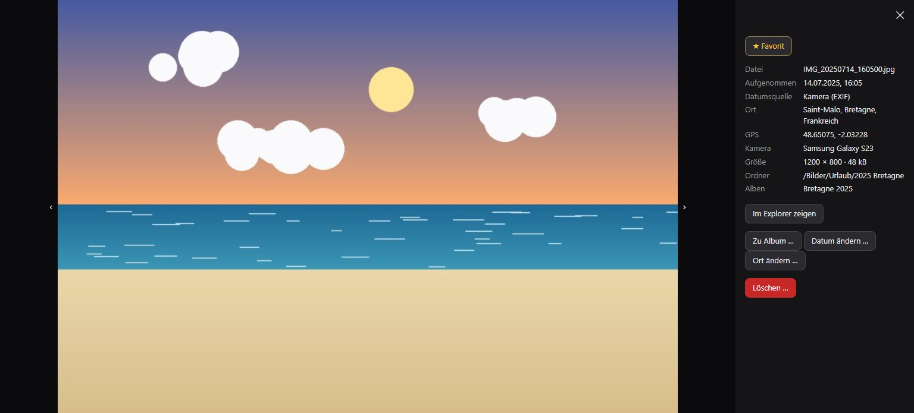
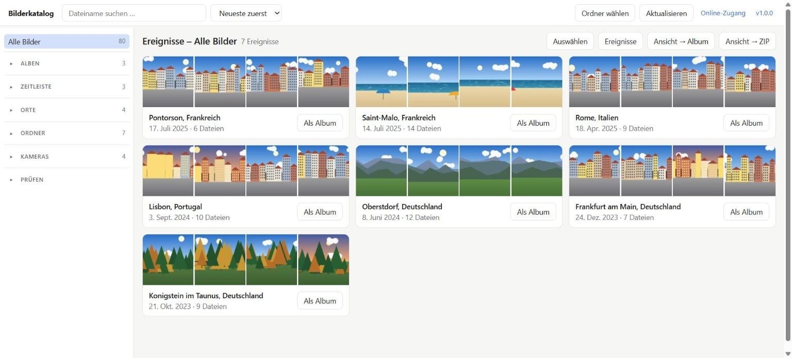
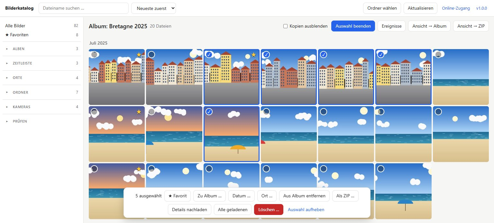

# Bilderkatalog – Benutzerhandbuch

Stand: Version 1.0.0.

Der Bilderkatalog hilft dir, viele tausend Fotos in deinem OneDrive (oder in jedem anderen Ordner) wiederzufinden und zu ordnen: nach Datum, Ort, Ordner und Kamera, in eigenen Alben und als ZIP zum Weitergeben. **Deine Bilder werden dabei nie verschoben, umbenannt oder verändert.** Alles, was du ordnest, steht nur im Katalog des Programms.

## Inhalt

1. [Überblick](#1-überblick)
2. [Installation und Updates](#2-installation-und-updates)
3. [Erster Start: Ordner wählen](#3-erster-start-ordner-wählen)
4. [Bilder ansehen](#4-bilder-ansehen)
5. [Filtern und Gruppieren](#5-filtern-und-gruppieren)
6. [Bilder, die nur online liegen](#6-bilder-die-nur-online-liegen)
7. [Alben](#7-alben)
8. [Ereignisse](#8-ereignisse)
9. [Auswählen und als ZIP exportieren](#9-auswählen-und-als-zip-exportieren)
10. [Deine Daten](#10-deine-daten)
11. [Optional: Online-Zugang über Microsoft](#11-optional-online-zugang-über-microsoft)
12. [Fragen und Probleme](#12-fragen-und-probleme)

## 1. Überblick


Das Fenster hat drei Bereiche:

- **Oben** die Suche nach Dateinamen, die Sortierung und die Knöpfe *Ordner wählen* und *Aktualisieren*. Ganz rechts steht die Versionsnummer.
- **Links** die Seitenleiste mit allen Gruppen: Alben, Zeitleiste, Orte, Ordner, Kameras und Prüflisten. Jede Gruppe lässt sich auf- und zuklappen, beim Start sind alle eingeklappt.
- **In der Mitte** das Bildraster. Es ist nach Monaten gegliedert und lädt beim Scrollen automatisch weiter.

Ein paar Grundsätze:

- **Nur lesen:** Das Programm verändert keine Bilder und keine Ordner. Alben und Gruppen gibt es nur im Katalog.
- **Ohne Anmeldung:** Es liest deinen OneDrive-Ordner direkt auf dem PC. Ein Microsoft-Konto oder eine Registrierung ist nicht nötig.
- **Offline:** Orte werden aus den GPS-Daten der Fotos auf deinem Rechner bestimmt. Es werden keine Bilder oder Koordinaten verschickt.
- **Schonend:** Bilder, die nur online liegen, werden zum Einlesen **nicht** heruntergeladen.

## 2. Installation und Updates

### Installieren

1. Auf der [Download-Seite](https://github.com/mbruver-source/bilderkatalog/releases/latest) unter „Assets“ die Datei `Bilderkatalog-Setup-X.Y.Z.exe` herunterladen.
2. Die Datei starten. Administratorrechte brauchst du nicht. Auf Wunsch legt das Setup eine Desktop-Verknüpfung an.
3. Windows zeigt eventuell **„Der Computer wurde durch Windows geschützt“**. Das liegt daran, dass die Setup-Datei noch nicht digital signiert ist. Dann auf **Weitere Informationen** und **Trotzdem ausführen** klicken. Das ist nur einmal nötig.

Voraussetzung ist Windows 10 oder 11 (64 Bit). Das Programmfenster nutzt den in Windows eingebauten *Microsoft Edge WebView2*.

### Updates

Oben rechts auf die Versionsnummer (z. B. **v1.0.0**) klicken, dann auf **Nach Updates suchen**. Gibt es eine neue Version, öffnet **Herunterladen** die Download-Seite. Die neue Setup-Datei einfach über die alte installieren. Läuft das Programm noch, bittet das Setup darum, es zu schließen. Dein Katalog mit allen Alben bleibt erhalten.

### Deinstallieren

Über *Einstellungen → Apps → Installierte Apps → Bilderkatalog → Deinstallieren*. Dabei werden nur die Programmdateien entfernt. Dein Katalog bleibt in `%LOCALAPPDATA%\bilderkatalog` liegen, damit er nach einer Neuinstallation wieder da ist. Möchtest du ihn auch loswerden, lösche diesen Ordner von Hand (siehe [Deine Daten](#10-deine-daten)).

## 3. Erster Start: Ordner wählen

Beim ersten Start öffnet sich **Ordner wählen** automatisch.

1. Unter **Lokal hinzufügen** steht dein OneDrive-Ordner. Mit **Hinzufügen** erfasst du ihn ganz. Mit dem kleinen Pfeil klappst du ihn auf und wählst nur einzelne Unterordner, zum Beispiel `Bilder` oder `Pictures\Camera Roll`.
2. Andere Ordner (z. B. eine externe Festplatte) trägst du unten als Pfad ein, etwa `D:\Fotos`.
3. Auf **Fertig** klicken, dann oben auf **Aktualisieren**.

Das Einlesen läuft im Hintergrund, der Fortschritt steht in der Leiste unter der Kopfzeile. Auch zehntausende Bilder sind in wenigen Minuten erfasst. Später liest **Aktualisieren** nur noch neue und geänderte Dateien. Verschobene oder umbenannte Bilder behalten dabei ihre Albumzuordnung.

> Einen Ordner, der schon in einem erfassten Ordner liegt, kannst du nicht noch einmal hinzufügen. Fügst du einen übergeordneten Ordner hinzu, gehen die bisherigen Unterordner darin auf.

Mit **Entfernen** nimmst du einen Ordner wieder aus dem Katalog. Die Dateien selbst bleiben natürlich unverändert.

**Woher kommt das Datum?** Zuerst aus den Kameradaten im Bild (EXIF). Fehlen sie, aus dem Dateinamen (z. B. `IMG-20190312-WA0001.jpg`), erst danach aus der Änderungszeit der Datei. Welche Quelle verwendet wurde, siehst du in der [Großansicht](#4-bilder-ansehen).

## 4. Bilder ansehen

- **Klick auf ein Bild** öffnet die Großansicht.
- Mit den **Pfeiltasten** ← → oder den Pfeilen am Rand blätterst du weiter, **Esc** schließt.
- Rechts stehen alle Angaben: Aufnahmezeit und Datumsquelle, Ort, GPS, Kamera, Größe, Ordner und die Alben, in denen das Bild liegt.
- **Im Explorer zeigen** öffnet den Ordner mit der Datei, **Zu Album …** legt das Bild in ein Album.



Oben in der Kopfzeile:

- **Dateiname suchen …** filtert nach einem Teil des Namens, z. B. `WA0` für Messenger-Bilder.
- **Sortierung:** Neueste oder Älteste zuerst, Name, Ort oder Größe. Bei Datum und Ort gliedern Zwischenüberschriften das Raster.

## 5. Filtern und Gruppieren

Ein Klick auf einen Eintrag in der Seitenleiste zeigt nur die passenden Bilder. Die Zahl dahinter sagt, wie viele es sind.

| Gruppe | Was sie zeigt |
|---|---|
| **Alle Bilder** | den ganzen Katalog |
| **Alben** | deine eigenen Zusammenstellungen (siehe [Alben](#7-alben)) |
| **Zeitleiste** | Jahre, darunter die Monate |
| **Orte** | Länder, darunter die Städte (aus den GPS-Daten) |
| **Ordner** | die Ordner, in denen die Bilder liegen |
| **Kameras** | Kamera- und Handymodelle |
| **Prüfen** | *Ohne Aufnahmedatum*, *Ohne GPS*, *Videos* und *Nur online, Details fehlen* |

Was du gerade siehst, kannst du komplett weiterverwenden:

- **Ansicht → Album** übernimmt alle Bilder der Ansicht in ein Album, zum Beispiel „alle Bilder aus Portugal“.
- **Ansicht → ZIP** packt alle Bilder der Ansicht in eine ZIP-Datei.

> Die Ortsnamen stammen aus dem freien Ortsverzeichnis GeoNames. Manche Städte heißen dort englisch, etwa „Rome“ oder „Lisbon“. Die Ländernamen sind deutsch.

## 6. Bilder, die nur online liegen

Mit „Dateien bei Bedarf“ liegen in OneDrive viele Bilder nur als Platzhalter auf dem PC (Wolkensymbol im Explorer). Der Bilderkatalog lädt sie zum Einlesen **nicht** herunter:

- Das **Aufnahmedatum** ist trotzdem sofort bekannt, weil Windows es im Platzhalter speichert.
- **Ort, Kamera und Vorschaubild** fehlen zunächst. Im Raster erscheint stattdessen ein Wolkensymbol mit Name und Datum.

Diese Angaben kannst du nachladen. Jedes Bild wird dafür kurz heruntergeladen, das Programm liest die Angaben aus, speichert ein kleines Vorschaubild und **gibt den Speicher sofort wieder frei**, genau wie „Speicherplatz freigeben“ im Explorer. An den Dateien in OneDrive ändert sich nichts.

| Knopf | Wo | Lädt |
|---|---|---|
| **Vorschau laden** | in der Großansicht | sofort dieses eine Bild |
| **Vorschau nachladen** | Auswahlleiste | die ausgewählten Bilder |
| **Vorschau nachladen (Anzahl)** | über dem Raster | alle Nur-online-Bilder der aktuellen Ansicht, z. B. eines Albums oder Monats |
| **Details nachladen (Anzahl)** | Kopfzeile | alle Nur-online-Bilder im Katalog |

Gut zu wissen:

- Das Nachladen dauert etwa **eine Sekunde pro Bild**. Bei vielen tausend Bildern läuft es also mehrere Stunden im Hintergrund. Du kannst jederzeit **Abbrechen** und später weitermachen, schon erledigte Bilder werden nicht noch einmal geladen.
- Der OneDrive-Client muss dafür laufen und angemeldet sein.
- Bei weniger als 2 GB freiem Speicher hält das Nachladen an.
- Videos werden nie nachgeladen, bei ihnen bleibt es beim Datum.

## 7. Alben

Alben sind virtuelle Ordner. Ein Bild kann in beliebig vielen Alben liegen, ohne kopiert zu werden.

- **Neues Album:** in der Seitenleiste unter *Alben* auf **+ Neues Album**.
- **Bilder hinzufügen:** Bilder auswählen und in der Auswahlleiste **Zu Album …** wählen. Dort kannst du auch gleich ein neues Album anlegen. Aus der Großansicht geht es mit **Zu Album …**.
- **Ganze Ansicht übernehmen:** **Ansicht → Album**, etwa nach einem Klick auf einen Ort oder Monat.
- **Bilder entfernen:** Album öffnen, Bilder auswählen, **Aus Album entfernen**. Die Bilder selbst bleiben erhalten.

## 8. Ereignisse

Der Knopf **Ereignisse** über dem Raster sucht zusammengehörende Bilder: mindestens fünf Bilder, zwischen denen höchstens sechs Stunden liegen und die am selben Ort entstanden sind, zum Beispiel ein Ausflug oder ein Urlaubstag.



- Ein Klick auf die Vorschaubilder zeigt die Bilder des Ereignisses.
- **Als Album** speichert das Ereignis als Album.

Ereignisse beziehen sich immer auf die aktuelle Ansicht. Erst ein Jahr anklicken und dann *Ereignisse* zeigt nur die Ereignisse dieses Jahres.

## 9. Auswählen und als ZIP exportieren

**Auswählen** über dem Raster schaltet den Auswahlmodus ein:

- Jeder Klick auf ein Bild wählt es aus oder ab. **Shift-Klick** wählt alles bis zum zuletzt angeklickten Bild.
- Unten erscheint die Auswahlleiste mit **Zu Album …**, **Aus Album entfernen** (nur in einem Album), **Als ZIP …**, **Vorschau nachladen** und **Alle geladenen**.
- **Auswahl beenden** oder **Esc** schaltet den Modus wieder aus.

Auch ohne Auswahlmodus kannst du auf den kleinen Kreis oben links in einem Bild klicken.



### ZIP-Export

Bei **Als ZIP …** bzw. **Ansicht → ZIP** wählst du:

- **Name** der ZIP-Datei. Datum und Uhrzeit hängt das Programm automatisch an.
- **Ordnerstruktur im ZIP:** alle Dateien direkt, nach Jahr/Monat oder wie im Originalordner
- **Zielordner**, standardmäßig dein Download-Ordner

Die Originale werden unverändert ins ZIP kopiert. Bilder, die nur online liegen, werden dafür kurz geladen und danach wieder freigegeben. Der Fortschritt steht in der Leiste oben, am Ende erscheint der Speicherort.

## 10. Deine Daten

Alles bleibt auf deinem Rechner, im Ordner

```
%LOCALAPPDATA%\bilderkatalog
```

Dort liegen der Katalog (`katalog.db` mit Alben und Angaben zu den Bildern), die Vorschaubilder (`thumbs`, etwa 20 KB pro Bild) und eine Protokolldatei. Den genauen Pfad zeigt das Versionsfenster (Klick auf die Versionsnummer oben rechts).

- Das Programm schickt **keine Bilder, Ortsdaten oder Dateinamen** ins Internet. Nur **Nach Updates suchen** fragt auf deinen Klick hin bei GitHub nach der neuesten Versionsnummer.
- Das Programm ist nur auf deinem eigenen Rechner erreichbar, nicht im Netzwerk.
- **Zurücksetzen:** Programm schließen und den Ordner oben löschen. Beim nächsten Start beginnt der Katalog leer, deine Bilder sind davon nicht betroffen.

### Lizenzen

Der Bilderkatalog ist freie Software unter der MIT-Lizenz. Er bringt Bibliotheken anderer Projekte mit, deren Lizenzen im Programm unter **Versionsnummer → Lizenzen der mitgelieferten Software** stehen und als `THIRD_PARTY_LICENSES.txt` im Programmordner liegen. Die Ortsdaten stammen von [GeoNames.org](https://www.geonames.org) (Lizenz CC BY 4.0).

## 11. Optional: Online-Zugang über Microsoft

Für den normalen Gebrauch nicht nötig. Der Online-Zugang über die Microsoft-Graph-Schnittstelle hat nur einen Vorteil: Ort, Kamera und Vorschaubilder auch von Nur-online-Bildern kommen **ohne Download**. Dafür brauchst du eine eigene, kostenlose App-Registrierung bei Microsoft. Je nach Konto verlangt Microsoft dafür ein Azure-Konto.

Die Einrichtung steht in der [README](../README.md#optional-online-zugang-über-microsoft-graph). Danach auf **Online-Zugang** oben rechts klicken, die Client-ID eintragen und anmelden. Das Programm fordert nur Leserechte an (`Files.Read`).

> Erfasse dieselben Bilder nicht lokal **und** online, sonst erscheinen sie doppelt.

## 12. Fragen und Probleme

**Windows blockiert den Download oder den Start.**
Blockiert der Browser die Datei, die Download-Liste öffnen (Chrome und Edge: <kbd>Strg</kbd> + <kbd>J</kbd>) und **Behalten** wählen. Beim Start: **Weitere Informationen → Trotzdem ausführen**, siehe [Installation](#2-installation-und-updates).

**Das Fenster bleibt weiß oder öffnet sich nicht.**
Das Programm braucht den *Microsoft Edge WebView2 Runtime*, der in Windows 10 und 11 normalerweise schon installiert ist. Fehlt er, gibt es ihn kostenlos bei Microsoft („WebView2 Runtime herunterladen“).

**Ein Bild zeigt kein Vorschaubild.**
Liegt es nur online (Wolkensymbol), siehe [Bilder, die nur online liegen](#6-bilder-die-nur-online-liegen). Manche Formate (z. B. RAW-Dateien, Videos) haben keine Vorschau. iPhone-Fotos (HEIC) brauchen einen zusätzlichen Baustein, der im Installer noch nicht enthalten ist.

**Ein Bild steht im falschen Jahr.**
In der Großansicht zeigt *Datumsquelle*, woher das Datum stammt. Bei „Dateizeit“ hatte das Bild keine Kameradaten. Die Liste **Prüfen → Ohne Aufnahmedatum** zeigt alle solchen Bilder.

**Das Nachladen bricht mit einem Fehler ab.**
Prüfen, ob OneDrive läuft und genug Speicher frei ist. Einzelne fehlerhafte Dateien werden übersprungen und beim nächsten Mal erneut versucht.

**Fehler melden.**
Über [GitHub Issues](https://github.com/mbruver-source/bilderkatalog/issues). Hilfreich ist die Protokolldatei `bilderkatalog.log` aus dem Datenordner. **Bitte keine privaten Fotos anhängen.**

Für die Fehlersuche gibt es außerdem einen Selbsttest. Er prüft alle Bestandteile des Programms in einem Testordner, deine Daten werden dabei nicht berührt:

```
"%LOCALAPPDATA%\Programs\Bilderkatalog\Bilderkatalog.exe" --selbsttest
```

Das Ergebnis steht danach in `%TEMP%\bilderkatalog_selbsttest.log`. Wurde das Programm mit Adminrechten installiert, liegt es unter `C:\Program Files\Bilderkatalog`.
